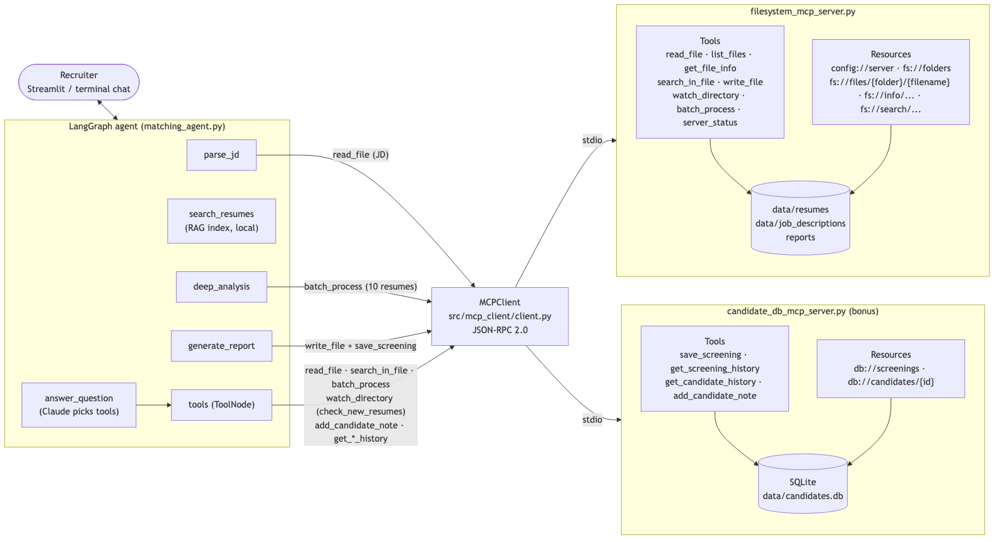
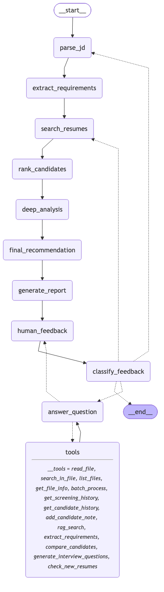

# MCP Integration: Resume Matching Agent (Milestone 4)

The Milestone 3 LangGraph agent, rebuilt on the **Model Context Protocol (MCP)**. The file system tools from
Milestone 1 now run as an **MCP server**. The agent is an **MCP client**: it discovers the tools and resources
over JSON-RPC 2.0 instead of importing Python functions. A second MCP server (a SQLite candidate database)
shows one agent using several MCP servers.



| Part | Technology |
|---|---|
| MCP servers | Official `mcp` Python SDK (FastMCP), JSON-RPC 2.0 over stdio (or streamable HTTP) |
| MCP client | `src/mcp_client/client.py`: one open session per server, MCP tools turned into LangChain tools |
| Agent / state machine | LangGraph (same graph as Milestone 3: 3 screening rounds, human feedback loop) |
| Reasoning (LLM) | Claude via `langchain-anthropic`, structured output with Pydantic |
| Search (Milestone 2) | bge-small embeddings + FAISS + BM25 hybrid search (local index) |
| Chat interface | Streamlit (with an **MCP servers** tab) and terminal |

## Setup

```bash
uv venv -p 3.12 .venv && uv pip install -p .venv/bin/python -r requirements.txt
# or: python3.12 -m venv .venv && .venv/bin/pip install -r requirements.txt
source .venv/bin/activate
cp .env.example .env              # then add your ANTHROPIC_API_KEY
```

You don't start the MCP servers yourself. The agent starts them as subprocesses, using `src/config/mcp_servers.json`.

## Run

| What | Command |
|---|---|
| **Streamlit chat** | `streamlit run src/ui/streamlit_app.py` |
| Terminal chat | `python -m src.ui.chat_cli` |
| One screening, no chat | `python -m src.agent.matching_agent data/job_descriptions/teacher.txt` |
| What the agent discovered over MCP | `python -m src.agent.matching_agent --mcp` |
| Raw JSON-RPC 2.0 messages, step by step | `python scripts/jsonrpc_demo.py` |
| Filesystem server on its own (stdio) | `python -m src.mcp_servers.filesystem_mcp_server` |
| Filesystem server as a web service | `python -m src.mcp_servers.filesystem_mcp_server --transport http --port 8765` → `http://127.0.0.1:8765/mcp` |
| Inspect a server in the browser | `npx @modelcontextprotocol/inspector .venv/bin/python -m src.mcp_servers.filesystem_mcp_server` |
| Simulate a new applicant | `python scripts/drop_new_resume.py --delay 5` (remove again with `--cleanup`) |
| Guided tour of both MCP servers (no LLM) | `python scripts/mcp_client_demo.py` |
| **Demo video** (terminal recording) | [demo/mcp_demo.mp4](demo/mcp_demo.mp4). Re-record with `vhs demo/demo.tape` (`brew install vhs`) |
| Diagrams | `python -m src.agent.matching_agent --diagram` |
| Offline tests (no API key) | `pytest tests/test_mcp_server.py tests/test_mcp_client.py tests/test_tools.py -v` |
| All tests | `pytest -v` (the conversation tests call Claude and take several minutes) |

Run everything from the project root.

### Things to say to the agent
- Start: pick a JD in the sidebar, type a JD name like `it_systems_admin`, or ask *"Find me candidates with SQL and 3+ years experience"*
- *"Compare the top 3 matches side by side"*, *"Why did A rank higher than B?"*, *"Make Linux a must-have"*
- *"Does the top candidate's resume mention Windows? Quote the line."* → MCP `search_in_file`
- *"Check for new resumes for the next 30 seconds"* → MCP `watch_directory` + `batch_process` (drop a file with `scripts/drop_new_resume.py`)
- *"Add a note for Elena Reed: available from January"*, *"What did we screen before?"* → `candidate_db` MCP server
- *"done"*

## Part A: the filesystem MCP server (`src/mcp_servers/filesystem_mcp_server.py`)

**Tools** (each has a JSON schema built from its type hints, and a description from its docstring):

| Tool | |
|---|---|
| `read_file`, `list_files`, `get_file_info`, `search_in_file`, `write_file` | Milestone 1 tools. The server reuses `src/file_system/fs_tools.py` |
| `watch_directory(directory, timeout_seconds)` | **New.** Waits for new, changed or removed resumes and returns as soon as something changes. Remembers a snapshot between calls, so files added between two calls are not missed. Sends progress notifications while waiting |
| `batch_process(paths \| directory, operation, keyword, max_chars)` | **New.** Read / info / search many files in one call, in parallel (thread pool). One bad file is reported in `errors` and does not stop the batch |
| `server_status()` | Health check |

**Resources** (discovered with `resources/list` and `resources/templates/list`): `config://server`, `fs://folders`,
`fs://files/{folder}`, `fs://files/{folder}/{filename}`, `fs://info/{folder}/{filename}`,
`fs://search/{folder}/{filename}/{keyword}`. These are the Milestone 1 tools as read-only data.

**Error handling:** tool errors come back with `isError: true` and a status code (`ACCESS_DENIED`, `NOT_FOUND`,
`UNSUPPORTED_TYPE`, `TOO_LARGE`, ...). Resource errors are JSON-RPC errors with proper codes (`-32002` not found,
`-32602` invalid params). **Security:** every path must be inside an allowed folder, and writing only works in `reports/`.

**Configuration:** `src/config/filesystem_server.json` (allowed folders, limits) with `MCP_FS_*` environment variable
overrides. `src/config/mcp_servers.json` sets which servers the client starts (Claude Desktop format).

Details, message examples and all error codes: **[docs/MCP_ARCHITECTURE.md](docs/MCP_ARCHITECTURE.md)**

## Part B: the refactored agent (`src/agent/matching_agent.py`)

- **No direct file system tools.** `src/agent/` and `src/ui/` don't import `src.file_system` any more (a test checks this).
  The JD, the resumes and the reports are all read and written through the MCP client.
- **Same functionality, cleaner architecture.** The graph (nodes, edges, state) is unchanged, so the agent behaves as in Milestone 3.
  Round 2 now reads all 10 shortlisted resumes with **one** `batch_process` call.
- **Tools are discovered.** Claude's file tools are built from the server's `tools/list` schemas (`MCPClient.langchain_tools()`).
  The agent's own tools (`rag_search`, `compare_candidates`, `generate_interview_questions`, `check_new_resumes`) are added to them.
- **Multi-MCP (bonus):** `candidate_db_mcp_server.py` stores every screening (saved automatically by `generate_report`) and
  recruiter notes in SQLite. Claude uses it through `get_screening_history`, `get_candidate_history` and `add_candidate_note`.

### State machine



```
START → parse_jd → extract_requirements → search_resumes → rank_candidates
      → deep_analysis → final_recommendation → generate_report → human_feedback ⇄ (pause for the user)
                                                                       ↓
                                                              classify_feedback
              refine  → search_resumes  (re-rank with the new must-haves, explain the changes)
              new_job → parse_jd        (start over with another job)
              question→ answer_question ⇄ tools (MCP tools + agent tools) → human_feedback
              done    → END
```

How each step uses MCP, as a sequence diagram: [docs/mcp_sequence.png](docs/mcp_sequence.png)

## Project layout

```
src/
  mcp_servers/         Milestone 4: filesystem_mcp_server.py, candidate_db_mcp_server.py, server_config.py
  mcp_client/          Milestone 4: client.py (MCPClient, get_mcp_client)
  agent/               matching_agent.py, nodes.py, tools.py (now MCP-based), state.py, schemas.py, llm.py
  config/              constants.py, mcp_servers.json, filesystem_server.json
  file_system/         Milestone 1 file functions (used only by the MCP server and the index builder)
  rag/                 Milestone 2 search: resume_rag.py, job_matcher.py, skills.py, ...
  ui/                  streamlit_app.py, chat_cli.py, common.py
data/
  resumes/             100 resume PDFs + FAISS index in data/index/
  job_descriptions/    8 sample JDs
  new_resumes/         sample "new applicants" for the watch_directory demo
docs/                  MCP_ARCHITECTURE.md, diagrams, TEST_SCENARIOS.md, DEMO_SCRIPT.md
scripts/               jsonrpc_demo.py, drop_new_resume.py, fetch_resumes.py, build_ground_truth.py
tests/                 test_mcp_server.py, test_mcp_client.py, test_tools.py (offline), test_scenarios.py (Claude)
```

## Tests

- **Offline (46 tests, no API key, about 1 minute):** `tests/test_mcp_server.py` (26), `tests/test_mcp_client.py` (8), `tests/test_tools.py` (12)
- **Conversation flows (10, call Claude):** `tests/test_scenarios.py`. The 7 Milestone 3 flows, plus: MCP file tools
  answering a question, a new resume detected while the agent watches, and notes + history from the second MCP server.

See [docs/TEST_SCENARIOS.md](docs/TEST_SCENARIOS.md).

## Notes

- The project uses the `mcp` SDK 1.x API (`from mcp.server.fastmcp import FastMCP`), which most tutorials use. `mcp` 2.x renamed this API, so `requirements.txt` pins `mcp<2`.
- New resumes found by `watch_directory` are analysed by Claude but are not added to the FAISS index. To include them in ranked searches, rebuild the index: `python -m src.rag.cli build`.
- A stdio MCP server must never `print()`, because stdout carries the JSON-RPC messages.
