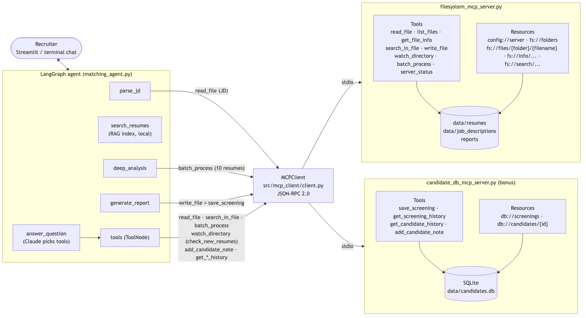
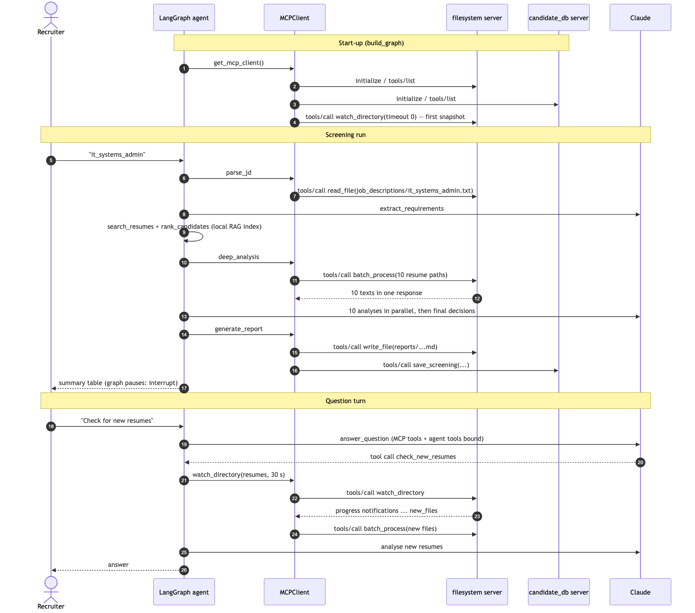

# Agent ↔ MCP architecture

## The big picture



The agent no longer opens files itself. It is an **MCP client** that talks to two **MCP servers**:

| Server | File | What it owns | Transport |
|---|---|---|---|
| `filesystem` | `src/mcp_servers/filesystem_mcp_server.py` | resumes, job descriptions, reports (sandboxed folders) | stdio (or HTTP with `--transport http`) |
| `candidate_db` (bonus) | `src/mcp_servers/candidate_db_mcp_server.py` | past screenings + recruiter notes (SQLite) | stdio |

The client (`src/mcp_client/client.py`) starts both servers from `src/config/mcp_servers.json`, does the
`initialize` handshake, discovers their tools (`tools/list`) and resources (`resources/list`,
`resources/templates/list`), and keeps one session per server open for the whole program.

The search index (FAISS + BM25 from Milestone 2) is still used directly by the agent. It is not a file tool.

## The flow of one conversation



## Where the agent uses MCP

| Agent step | MCP server | MCP call |
|---|---|---|
| start-up (`build_graph`) | both | `initialize`, `tools/list`; `watch_directory(timeout 0)` takes the first snapshot of `data/resumes` |
| `parse_jd` | filesystem | `read_file("job_descriptions/teacher.txt")` |
| `deep_analysis` (round 2) | filesystem | **one** `batch_process` call reads all 10 shortlisted resumes |
| `generate_report` | filesystem | `write_file("reports/<job>_<time>.md")` |
| `generate_report` | candidate_db | `save_screening(job, filters, ranked candidates + decisions)` |
| `answer_question` → `tools` | filesystem | Claude calls `read_file`, `search_in_file`, `batch_process`, `list_files`, `get_file_info` |
| `answer_question` → `tools` | candidate_db | Claude calls `get_screening_history`, `get_candidate_history`, `add_candidate_note` |
| `check_new_resumes` tool | filesystem | `watch_directory` (waits for new files), then `batch_process` (reads them all) |
| `compare_candidates`, `generate_interview_questions` | filesystem | `read_file` for the resume text |

Claude's tools are **discovered, not hand-written**. `MCPClient.langchain_tools()` turns each MCP tool's
name, description and JSON schema (from `tools/list`) into a LangChain `StructuredTool`. If the server
gets a new tool, add its name to `MCP_TOOLS_FOR_LLM` in `src/config/constants.py`. No new agent code is needed.

`write_file` and `watch_directory` are deliberately **not** given to Claude directly. Reports are written
by the graph, and watching is wrapped in `check_new_resumes`, which also reads and analyses the new files.

## JSON-RPC 2.0 messages

Run `python scripts/jsonrpc_demo.py` to see the real messages. Each one is a single line of JSON on stdin/stdout:

```json
--> {"jsonrpc": "2.0", "id": 5, "method": "tools/call",
     "params": {"name": "read_file", "arguments": {"path": "data/resumes/chen_martin.pdf", "max_chars": 120}}}
<-- {"jsonrpc": "2.0", "id": 5, "result": {"content": [{"type": "text", "text": "{...}"}],
     "structuredContent": {"success": true, "path": "data/resumes/chen_martin.pdf", "content": "SALES ASSOCIATE ..."},
     "isError": false}}
```

- **Request:** has an `id`. The response carries the same `id`.
- **Notification:** has no `id` and gets no response, e.g. `notifications/initialized`, or the
  `notifications/progress` messages that `watch_directory` sends while it waits.
- **Response:** has either `result` or `error`, never both.

## Error handling and status codes

There are two kinds of errors, as the MCP spec describes:

**1. Tool errors** (the tool ran but failed). The result is normal, with `"isError": true`. The text
starts with a status code, so a program can react to it:

| Code | When |
|---|---|
| `ACCESS_DENIED` | path outside the allowed folders (`../.env`, `/etc/passwd`), or writing outside `reports/` |
| `NOT_FOUND` | file or folder does not exist |
| `NOT_A_FILE` | a folder was given where a file is needed |
| `UNSUPPORTED_TYPE` | not .pdf / .docx / .txt / .md (writing: only .txt / .md / .json) |
| `TOO_LARGE` | bigger than `max_file_size_mb` |
| `INVALID_ARGUMENT` | empty path or keyword, `search` without a keyword, ... |
| `TOO_MANY_FILES` | `batch_process` over `batch_max_files` |
| `ALREADY_EXISTS` | `write_file` with `overwrite: false` |
| `READ_FAILED` / `WRITE_FAILED` | the file could not be parsed or saved |

The client turns these into `{"success": False, "code": "NOT_FOUND", "error": "File not found: ..."}`,
so the agent and Claude can read them. In `batch_process`, one bad file is reported in `errors` and
the rest of the batch still runs.

**2. Protocol errors** (the request itself is wrong). The response has a JSON-RPC `error` object:

| JSON-RPC code | When |
|---|---|
| `-32002` | resource not found (`fs://files/resumes/nobody.pdf`, unknown folder or URI) |
| `-32602` | invalid params (e.g. `fs://files/resumes/..%2F.env`). The SDK also uses it for unknown methods |
| `-32603` | internal error while reading a resource |

Plain FastMCP answers every failed `resources/read` with code `0`. Our `FilesystemMCP` class overrides
`read_resource` to send the correct code.

## Resources: the Milestone 1 tools as read-only data

| Resource | Same as |
|---|---|
| `fs://files/{folder}` | `list_files` |
| `fs://files/{folder}/{filename}` | `read_file` |
| `fs://info/{folder}/{filename}` | `get_file_info` |
| `fs://search/{folder}/{filename}/{keyword}` | `search_in_file` |
| `fs://folders`, `config://server` | discovery: which folders exist, the active configuration |
| `db://screenings`, `db://candidates/{candidate_id}` | candidate_db server |

`write_file` exists only as a tool, because MCP resources are read-only.

## Configuration

| File | What it configures |
|---|---|
| `src/config/mcp_servers.json` | which servers the client starts (same format as Claude Desktop's config). `"command"` + `"args"` for stdio, or `"url"` for an HTTP server |
| `src/config/filesystem_server.json` | allowed / writable folders, file types, size limit, batch and watch limits |
| environment variables | `MCP_FS_MAX_FILE_SIZE_MB`, `MCP_FS_BATCH_MAX_WORKERS`, `MCP_FS_WATCH_MAX_SECONDS`, ... override the JSON. `MCP_FS_CONFIG` points to another JSON file. `CANDIDATE_DB_PATH` moves the database |

Settings are applied in order: defaults → JSON file → environment. The active result can be read from the `config://server` resource.

## Security

- Every path is resolved (`..` and symlinks included) and must lie inside an `allowed_dirs` folder.
- Writing is limited to `writable_dirs` (`reports/`) and to text formats.
- A `stdio` server must never `print()`, because stdout carries the JSON-RPC messages. Logs go to stderr at WARNING level.
